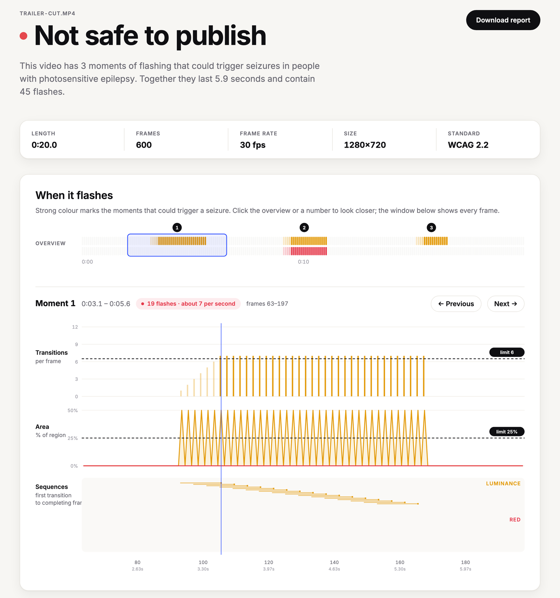
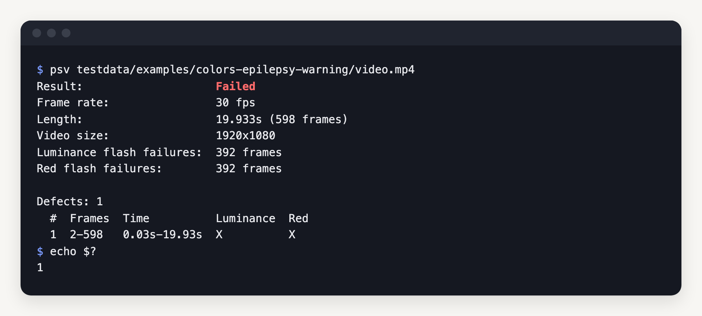
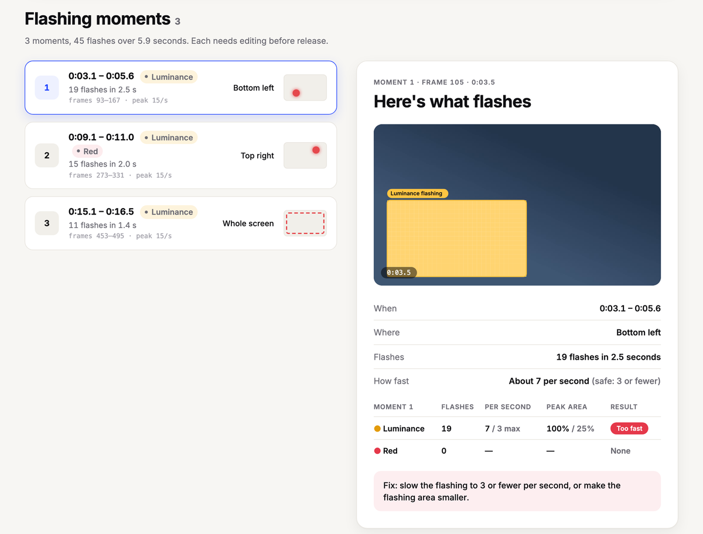
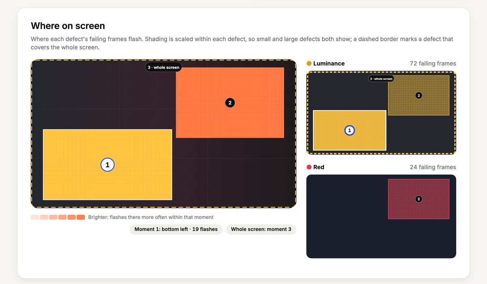

<p align="center">
  
</p>

<h1 align="center">Photosafety Validator</h1>

<p align="center">
  <b>Photosensitive epilepsy checker; a Go library, CLI and API server that finds hazardous flashing in video against WCAG 2.2 and broadcast guidelines.</b>
</p>

<p align="center">
  PSV finds general (luminance) flashes and red flashes, measures how much of the screen flashes together and how often,<br>
  and reports a pass or fail verdict with the frames and screen regions involved.<br>
  <i>By Brian Nunez.</i>
</p>

<p align="center">
  
  
  
  
</p>

<p align="center">
  <a href="#quick-start"></a>
</p>

<p align="center">
  <a href="#quick-start"><b>Quick start</b></a> ·
  <a href="#report-ui">Report UI</a> ·
  <a href="#api-server">API server</a> ·
  <a href="docs/how-it-works.md">How it works</a> ·
  <a href="docs/testing.md">Testing</a>
</p>

<br>

<p align="center">
  
  <br><sub><b>Report UI</b>: <code>psv serve</code> after analysing a generated test clip; <code>psv render</code> writes the same page from a saved report.</sub>
</p>

<p align="center">
  
  <br><sub><b>Command line</b>: one of the repository's example videos through <code>psv</code>, with exit status 1 for a failed video.</sub>
</p>

> [!NOTE]
> **PSV checks flashing, not every visual hazard.** Regular spatial patterns such as stripes and checkerboards are a separate hazard and are not checked, and display brightness, HDR and viewing distance are not modelled. See the [design choices and limits](docs/how-it-works.md#design-choices-and-limits).

<p align="center">
  <a href="#why-psv">Why PSV</a> ·
  <a href="#quick-start">Quick start</a> ·
  <a href="#usage">Usage</a> ·
  <a href="#report-ui">Report UI</a> ·
  <a href="#api-server">API server</a> ·
  <a href="#library">Library</a> ·
  <a href="#conformance">Conformance</a>
</p>

## Why PSV

- **Standards-based.** Implements [WCAG 2.2 Success Criterion 2.3.1](https://www.w3.org/TR/WCAG22/#three-flashes-or-below-threshold) by default, with presets for the Trace R&D Center's 2024 guidelines, the broadcast guidelines (ITU-R BT.1702, Ofcom, ISO 9241-391) and an experimental scene-change rule.
- **Benchmarked.** Tested against every video of the [Trace RERC PSE test media](https://github.com/traceRERC/pse-test-media), a benchmark built to sit just above or just below each threshold of each standard. See [Conformance](#conformance).
- **Specific.** Failures name their frames, times and screen regions, and per-frame JSON locates the flashing pixels wherever they are in the frame.
- **Pipeline-ready.** The exit status is `0` when the video passes, `1` when it fails and `2` on an error, so `psv` can gate a build or upload pipeline.
- **One report everywhere.** The CLI and the API both produce the same `psv.report/v1` JSON, and `psv render` shows it in the same report UI the API server serves.
- **Embeddable.** The repository is a Go module with one core package, `psv`, and thin apps on top of it: the CLI, API server and report UI live in `cmd/psv` and `internal`. Apps with their own decoded frames can stream them straight to an `Analyzer`.

## Quick start

```sh
make build                     # build bin/psv
./bin/psv video.mp4            # check a video against WCAG 2.2
./bin/psv serve                # report UI and API at http://127.0.0.1:8080
make install                   # or install psv to $GOPATH/bin
```

Requirements:

- Go 1.25 or later
- `ffmpeg` and `ffprobe` on `PATH`, or passed with `-ffmpeg` and `-ffprobe`
- For development: [golangci-lint](https://golangci-lint.run) v2

## Usage

```bash
./bin/psv testdata/examples/colors-epilepsy-warning/video.mp4
```

```text
Result:                    Failed
Frame rate:                30 fps
Length:                    19.933s (598 frames)
Video size:                1920x1080
Luminance flash failures:  392 frames
Red flash failures:        392 frames

Defects: 1
  #  Frames  Time          Luminance  Red
  1  2-598   0.03s-19.93s  X          X
```

The video is one of the [example videos](testdata/examples): every frame is solid green, red or blue in turn, one colour per frame. A defect is a run of frames covered by failing flash sequences, from the first transition of a sequence to the frame that completes it.

### Flags

| Flag | Default | Description |
| --- | --- | --- |
| `-standard` | `wcag22` | Threshold preset: `wcag22`, `trace24`, `broadcast` or `scene` |
| `-format` | `text` | `text` summary or `json` report |
| `-frames` | off | Include every frame's result in JSON output, which `psv render` needs |
| `-fps` | `0` | Convert the video to this frame rate before analysis |
| `-deinterlace` | off | Deinterlace frames flagged as interlaced |
| `-progress` | on in a terminal | Show progress on stderr |
| `-luminance-change` | preset | Relative luminance change of a luminance transition |
| `-dark-limit` | preset | Relative luminance the darker side of a transition must be below |
| `-red-change` | preset | u'v' chromaticity change of a red transition |
| `-red-saturation` | preset | R/(R+G+B) at which a colour is saturated red |
| `-region` | preset | Area region as `WIDTHxHEIGHT` pixels, `0x0` for the whole frame |
| `-area` | preset | Share of a region, in percent, that must flash together |
| `-transitions` | preset | Most alternating transitions allowed in any one second |
| `-ffmpeg`, `-ffprobe` | `PATH` | Locations of the FFmpeg tools |
| `-version` | | Print the version |

Threshold flags override single values of the chosen preset.

## Standards

| Preset | Luminance | Red | Area | Count |
| --- | --- | --- | --- | --- |
| **`wcag22`** | ΔY ≥ 0.1, darker < 0.8 | Δu'v' ≥ 0.2, one side R/(R+G+B) ≥ 0.8 | ≥ 25% of any 341×256 px region | > 6 alternating transitions in 1 s |
| `trace24` | as WCAG | as WCAG | ≥ 25% of any 416×416 px region | as WCAG |
| `broadcast` | as WCAG | as WCAG | ≥ 25% of the screen | as WCAG |
| `scene` | as WCAG | as WCAG | ≥ 80% of the screen | > 3 alternating transitions in 1 s |

ΔY is the change in relative luminance (0 to 1). On the 200 cd/m² display the broadcast guidelines assume, 0.1 is their 20 cd/m² threshold.

## JSON report

`-format json` prints the full report in the `psv.report/v1` format, which the API returns too. For the same video:

```json
{
  "schema": "psv.report/v1",
  "tool": {
    "name": "psv",
    "version": "9c1fefd"
  },
  "source": "video.mp4",
  "standard": "wcag22",
  "verdict": "Failed",
  "passed": false,
  "frameRate": 30,
  "frames": 598,
  "durationSeconds": 19.933333333,
  "width": 1920,
  "height": 1080,
  "thresholds": {
    "luminanceChange": 0.1,
    "darkLimit": 0.8,
    "redChange": 0.2,
    "redSaturation": 0.8,
    "regionWidth": 341,
    "regionHeight": 256,
    "areaPercent": 25,
    "maxTransitions": 6
  },
  "failures": {
    "luminance": 392,
    "red": 392
  },
  "defects": [
    {
      "firstFrame": 2,
      "lastFrame": 598,
      "luminance": true,
      "red": true,
      "index": 1,
      "startSeconds": 0.033333333,
      "endSeconds": 19.933333333
    }
  ]
}
```

With `-frames`, `results` adds one entry per frame. Each entry has `luminance` and `red` measurements for the region that transitioned in that frame with the most alternating transitions: how many fall within the last second (`transitions`), the frame the sequence started (`since`), the region (`region`, in source pixels), the share of it that transitioned together (`area`, percent) and whether the frame completes a failing sequence (`failed`).

Failing frames also locate what flashes, wherever it is in the frame: `flashing` is the bounding box, in source pixels, of the flashing pixels that start a transition in that frame, and `mask` (base64) gives their share, 0 to 100, of each cell of a 64×36 grid over the frame, row by row from the top left. Unlike `region`, which is the fixed-size area the threshold is measured in, these follow the shape of the flashing.

`tool.version` is the version of the build that made the report: `make build` stamps the `git describe` output (here the commit `9c1fefd`, as no release is tagged), and a plain `go build` reports `dev`. `standard` is the preset name, or `custom` when threshold flags change it. `psv render` and the report UI accept only `psv.report/v1` documents.

## Report UI

One report UI shows every report, whichever frontend made it: the verdict, a timeline of when the video flashes with per-frame transition and area charts against the limits, each flashing moment with what flashes in its frames, and maps of where on screen.

```sh
psv -format json -frames video.mp4 > report.json
psv render report.json > report.html      # a self-contained page of the report UI
psv render -open report.json              # write it to a temporary file and open it
psv -format json -frames video.mp4 | psv render -o report.html
```

| Flag | Default | Description |
| --- | --- | --- |
| `-o` | standard output | Write the page to this file |
| `-open` | off | Open the page in the browser; without `-o` it is written to a temporary file |

The page needs the per-frame results that `-frames` adds. To see the frames themselves, attach the video in the page; it stays in the browser.

<table>
<tr>
<td width="50%" valign="top"></td>
<td width="50%" valign="top"></td>
</tr>
</table>

## API server

`psv serve` runs the API and serves the report UI at `http://127.0.0.1:8080`. The server stores nothing: a client streams a video in, the response streams the analysis back, and the upload is deleted when the request ends.

| Flag | Default | Description |
| --- | --- | --- |
| `-addr` | `127.0.0.1:8080` | Listen address |
| `-max-upload` | `2048` | Largest video accepted, in MB |
| `-max-jobs` | `2` | Most analyses run at once |
| `-timeout` | `30m` | Longest time an analysis may take, upload included |
| `-ffmpeg`, `-ffprobe` | `PATH` | Locations of the FFmpeg tools |

| Endpoint | Description |
| --- | --- |
| `POST /v1/analyses?standard=wcag22&name=video.mp4` | The video is the request body; the response is newline-delimited JSON events |
| `GET /healthz` | `{"status":"ok"}` |
| `GET /` | The report UI |

```sh
curl -sN --data-binary @testdata/examples/colors-epilepsy-warning/video.mp4 'http://127.0.0.1:8080/v1/analyses?name=video.mp4'
```

```text
{"type":"received","bytes":45713}
{"type":"progress","frame":1,"total":598}
{"type":"progress","frame":8,"total":598}
…
{"type":"progress","frame":598,"total":598}
{"type":"report","report":{"schema":"psv.report/v1","tool":{"name":"psv","version":"9c1fefd"},…
```

That run sent 146 lines: `received` once the upload is stored, 144 `progress` events while frames are analysed, sent at most every 100 ms and for the last frame (without `total` when the container does not declare a frame count), and the `report`, shortened here; a failed analysis ends with `error` instead.

The report has per-frame results, so it can be saved and passed to `psv render`. Problems found before the analysis starts are answered with an error status and a JSON `{"error": ...}` body: `400` for an unknown standard or an empty body, `413` past the upload limit, `422` for a file FFmpeg cannot read and `429` when `-max-jobs` analyses are already running. A failure after that ends the stream with a `{"type":"error","error":...}` event. Closing the connection cancels the analysis.

## Library

```go
analysis, err := psv.AnalyzeFile(ctx, "video.mp4", psv.Options{})
if err != nil {
	return err
}

report := analysis.Report(false)
fmt.Println(report.Verdict, report.Failures.Luminance, len(report.Defects))
```

Apps that already have decoded frames, such as a screen recorder or a mobile camera feed, use an `Analyzer` directly. A frame is decided one second after it is analysed, because whether its pixels flash depends on what follows:

```go
a, err := psv.NewAnalyzer(30, 1920, 1080, psv.Config{Thresholds: psv.WCAG22()})
if err != nil {
	return err
}

for frame := range frames { // *psv.Frame: packed 8-bit sRGB, top row first
	n, err := a.Analyze(frame)
	if err != nil {
		return err
	}

	decided := a.Analysis().Frames
	for _, r := range decided[len(decided)-n:] {
		if r.Failed() {
			// warn: a failing sequence completed
		}
	}
}

verdict := a.Finish().Verdict()
```

## Conformance

PSV runs against the 346 videos of the [Trace RERC PSE test media](https://github.com/traceRERC/pse-test-media). A set built for several standards runs once per preset, which makes 378 checks: 369 pass, 0 fail and 9 are skipped because their listing entries contradict the thresholds they test. Each skip is explained in the [testing guide](docs/testing.md#upstream-errors).

```bash
make test                                    # run every test
go test -run TestConformance .               # the conformance suite alone
go test -run 'TestConformance/wcag22/' .     # one standard
make test-examples                           # the full-resolution example videos
```

The test media is vendored in `testdata/pse-test-media`, and real-world example videos with their reports are in [`testdata/examples`](testdata/examples).

## Documentation

- [How it works](docs/how-it-works.md): the detection model, its design choices and its limits.
- [Testing](docs/testing.md): the conformance suite and how it is scored.
- [Examples](testdata/examples/README.md): the real-world example videos and their reports.

## Development

```sh
make all                       # format check, lint, build
make test                      # run the race detector on a subset, then every test
make test-examples             # decode the full-resolution example videos
make clips                     # regenerate the small test clips
make serve                     # build and run the API server and report UI
make examples                  # regenerate the example reports
make lint                      # run golangci-lint
make fmt                       # format and apply lint fixes
make release                   # build every release binary and SHA256SUMS into dist/
```

### Releases

Releases are made by GitHub Actions, not from a local machine. The [CI workflow](.github/workflows/ci.yml) checks formatting, lint, vet and `make test` on each pull request and push to `main`, decoding the small clips in [`testdata/clips`](testdata/clips); the [Examples workflow](.github/workflows/examples.yml) decodes the full-resolution example videos on demand, one job per video. When CI passes on `main`, the [Release workflow](.github/workflows/release.yml) works out the next version from the [Conventional Commits](https://www.conventionalcommits.org/) since the last tag with [`scripts/next-version.sh`](scripts/next-version.sh), builds `psv` for Linux, macOS and Windows on amd64 and arm64, and publishes them with `SHA256SUMS` as a GitHub release.

| Commits since the last tag | Next version |
| --- | --- |
| None tagged yet | `v0.1.0` |
| A breaking change (`type!:` or a `BREAKING CHANGE:` footer) | Next major |
| `feat` | Next minor |
| `fix`, `perf`, `refactor`, `build`, `revert` or any other subject | Next patch |
| Only `docs`, `ci`, `chore`, `test` or `style` | No release |

`psv -version` prints the release's tag. A local `make build` stamps `git describe`, so between releases it shows the last tag, the commits since it and the commit.

## License

PSV is licensed under the [MIT License](LICENSE). Copyright (c) 2026 Brian Nunez.
